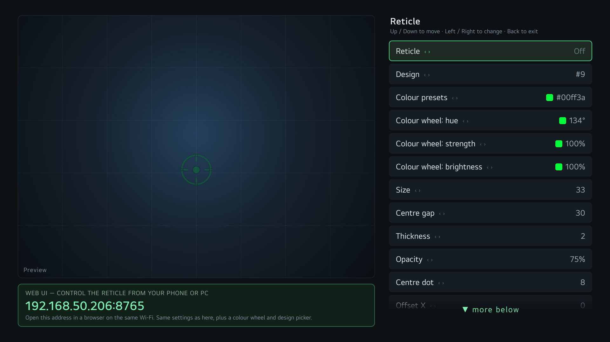

# Reticle — a crosshair overlay for LG webOS TVs

Draws a crosshair over an HDMI input (console, PC) **without touching the HDMI signal**,
so Game Mode, ALLM and the console's own HDR / VRR stay exactly as they were.

- 200 reticle designs (Kenney crosshair pack, CC0) plus six simple shapes
- every design can be thickened or thinned, given a centre gap, recoloured (colour wheel
  or presets), resized, nudged, and shown only on the inputs you choose
- control it **on the TV** (the app's settings screen) or **from a phone / PC** over a web page
- **starts off after every TV restart**; you turn it on when you want it
- stays on across input switches



## Requirements

A **rooted** LG TV with the [Homebrew Channel](https://www.webosbrew.org/). Tested on an
LG C4 (`OLED42C44LA`), webOS 9.2.4. The overlay and daemon use only features present
from webOS 5 up (Node 8+), but only the C4 has been tested.

## Install

Homebrew Channel (once listed), or from a release IPK:

```
scp org.hermes.reticle_<version>_all.ipk root@<tv-ip>:/tmp/reticle.ipk
```
then install it from the Homebrew Channel, or with `./install-on-tv.sh`. Open
**Reticle + Web UI** from the app list once; that links the start-at-boot hook and
starts the background daemon. After that the web page is at `http://<tv-ip>:8765/`
(the address is also shown on the settings screen).

Uninstalling the app removes everything it added, except the saved-settings backup in
`/media/developer/reticle-backup.json`.

## How it works

```
 org.hermes.reticle          main app: settings screen on the TV
 org.hermes.reticle.overlay  transparent full-screen canvas, hidden from the launcher
 org.hermes.reticle.service  luna service: stores the settings
 reticle daemon (Node)       web page + JSON API on :8765, relaunches the overlay,
                             switches the reticle off on boot. Started by the app
                             through the Homebrew Channel exec service and by an
                             init.d symlink at boot.
```

Two platform facts drive the design: an overlay window is hidden the moment any app
launches (including an HDMI input) and does not come back, so something outside the
overlay must relaunch it once the input is up; and the overlay is not the package's
main app, so it reads settings from the daemon over `127.0.0.1` instead of luna.

Design pictures are not shipped as images: `tools/convert-designs.py` turns the pack
into geometry that is redrawn at any size, thickness and gap. A few designs have an
explicit aim-point shift so the point you aim with sits on the exact screen centre.

## Build

```
./build.sh        # produces org.hermes.reticle_<version>_all.ipk
```

## How this was made

The idea, direction, testing on the TV and every decision are by the repository owner.
The code was written with substantial help from Claude (Anthropic's AI assistant), which
also did much of the on-TV debugging; the owner reviewed and tested the results. Stated
plainly because the webOS Homebrew rules ask for it.

## Licence

Code: MIT (`LICENSE`). Reticle artwork: Kenney Crosshair Pack, CC0 (`assets/LICENSE-Kenney-CC0.txt`).
